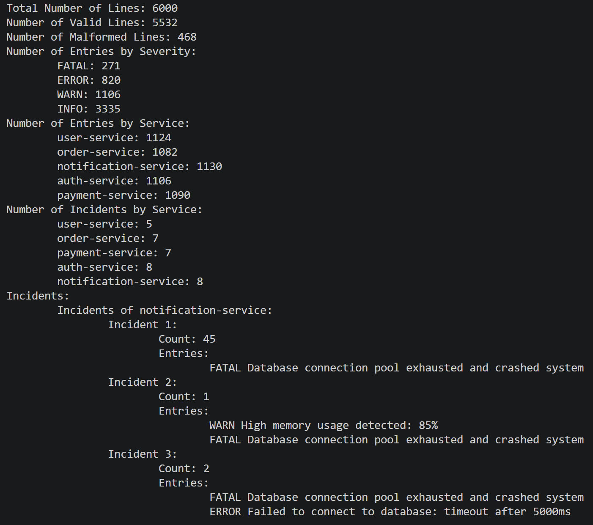

# GhostOps

A streaming log analysis CLI written in Go.

## About The Project

**GhostOps** analyzes application log files, computes summary statistics (entries by level and by service), detects incidents using configurable rules, and produces a report in the terminal and, optionally, as a JSON file.

Key features:

- Processes the log file line by line, so the whole file is never loaded into memory.
- Skips and counts malformed lines instead of aborting the analysis.
- Works on unsorted log files.
- Incident rules are configurable through a JSON file, with no code changes needed.
- Uses only the Go standard library.

## Getting Started

### Requirements

- Go 1.XX or later <!-- TODO: put the version from your go.mod -->

### Build

```bash
go build -o ghostops .
```

### Run

From the root directory of the project, either run directly:

```bash
go run . [-o <output.json>] [-s] [-t] <input.log>
```

or use the built binary:

```bash
./ghostops [-o <output.json>] [-s] [-t] <input.log>
```

`input.log` is the path to the log file to process. A sample log file, [`sample.log`](sample.log), is included in the repository:

```bash
go run . sample.log                  # full terminal report
go run . -s sample.log               # analytics only
go run . -t -o report.json sample.log  # show incident timestamps and write JSON
```

### Input Format

Each line of the input file must have this format:

```log
timestamp_in_rfc3339_format LEVEL service description
```

For example:

```log
2024-05-01T12:00:03Z ERROR payments Connection to database timed out
```

Other log formats are not supported. Lines that do not match this format (for example, a missing field, an invalid timestamp, or an unknown level) are treated as malformed: they are skipped, counted as malformed lines in the report, and do not stop the analysis.

### Output

With no flags, the terminal shows a report like this:



The report includes:

- The total number of valid entries and malformed lines.
- Entry counts by level.
- Entry counts by service.
- The detected incidents.

You can customize the terminal output or write the report to a JSON file with these flags:

| Flag | Input | Description |
|-|-|-|
| -o | Path to a JSON file (created if it doesn't exist) | Write the report to the specified JSON file |
| -s | None | Show a shortened terminal output (analytics only, no incidents). Doesn't affect the JSON output |
| -t | None | Show the timestamps of the entries in each incident in the terminal. Doesn't affect the JSON output |

The JSON output always includes the timestamps of the entries in each incident, and this cannot be changed. For an example, see [`sample-output.json`](sample-output.json).

## Defining Rules for Incidents

An incident is a group of log entries that:

- belong to the same service,
- have a level at or above a configured minimum,
- are close to each other in time, and
- contain enough entries of certain levels to pass a configured threshold.

<!-- TODO: the assignment says incidents should also be based on message content. If your implementation does that, document it here (and in the config table). If not, consider adding it. -->

You can customize these rules by editing [`incidentconfig.json`](incidentconfig.json):

| Key | Value Type | Description |
|-|-|-|
| ValidSeverityLevels | Array of Strings | The supported log levels, ordered from least to most severe. |
| MinSeverityLevel | Integer | The minimum level an entry must have to be considered for incidents. It is the index of the level in `ValidSeverityLevels`, starting from 0. |
| Duration | String or Integer | The maximum time gap allowed between two adjacent entries in the same incident. As a string, use Go duration syntax, such as `"30s"`, `"1m"` or `"2h30m"`. As an integer, the value is in nanoseconds. |
| MinEntriesBySeverity | Array of Integers | The minimum number of entries of each level required for a group to count as an incident. The first integer corresponds to the first level in `ValidSeverityLevels`, the second to the second level, and so on. |

### How Incidents Are Formed

- **Grouping by time:** Entries are chained. An entry joins an existing incident of the same service if its timestamp is within `Duration` of an entry already in that incident (before or after it). An incident can therefore be much longer than `Duration`, as long as there is no gap larger than `Duration` between adjacent entries.
- **Validity:** A group of entries only becomes an incident if it meets the minimum for **at least one** level in `MinEntriesBySeverity`. Each level is checked independently, and entries of different levels are not added together. <!-- TODO: confirm this matches your implementation -->

### Example

With the following configuration:

```json
{
  "ValidSeverityLevels": ["INFO", "WARN", "ERROR", "FATAL"],
  "MinSeverityLevel": 1,
  "Duration": "1m",
  "MinEntriesBySeverity": [0, 3, 2, 1]
}
```

a valid incident is a group of entries of one service in which:

- All entries have the level `WARN`, `ERROR` or `FATAL` (`INFO` entries are ignored).
- Two adjacent entries (in terms of time) are no more than one minute apart.
- The group has at least 3 `WARN` entries, **or** at least 2 `ERROR` entries, **or** at least 1 `FATAL` entry.

For example, 2 `WARN` entries and 1 `ERROR` entry in the same minute are **not** an incident, because none of the levels reaches its own minimum. <!-- TODO: confirm -->

### Identical Incidents

Incidents that repeat are reported once instead of being listed separately. Two log entries are considered equal if they match in every field except the timestamp (same level, service, and description). Two incidents are considered the same if they consist of the same set of equal entries. Identical incidents are grouped into a single reported incident that shows how many times it occurred (its frequency) and the timestamps of each occurrence. For example, if the same group of `WARN` entries from the `payments` service appears at 10:00, 10:45, and 14:20, the report shows one incident with a frequency of 3 and those three time ranges, not three separate incidents.

## Architecture and Design Decisions

### Package Structure

The project has two parts:

- **`main.go`** (root): The entry point. It parses command-line flags and arguments, opens the input file, calls the processor, prints the terminal report, and writes the JSON file when `-o` is given. It is the only place that deals with user input and output.
- **`processor/`**: The only package. It contains the logic for reading and analyzing the log file:
  - **`processor.go`**: The main loop. It reads the log file line by line, validates each line, counts valid and malformed lines, and updates the statistics. For entries that may belong to an incident, it calls the functions in `incident.go`.
  - **`incident.go`**: The types and functions for incidents. They add an entry to the list of incidents, validate the list against the rules in `incidentconfig.json`, and group identical incidents.

Data flows in one direction: `main.go` passes the input file to the processor, the processor returns the analysis results, and `main.go` turns them into the terminal and JSON reports.

The JSON report generation was not seperated into a different package because it was small enough.
